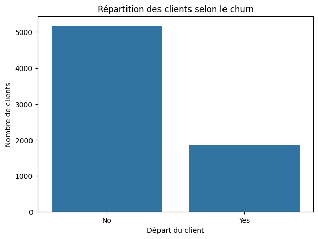
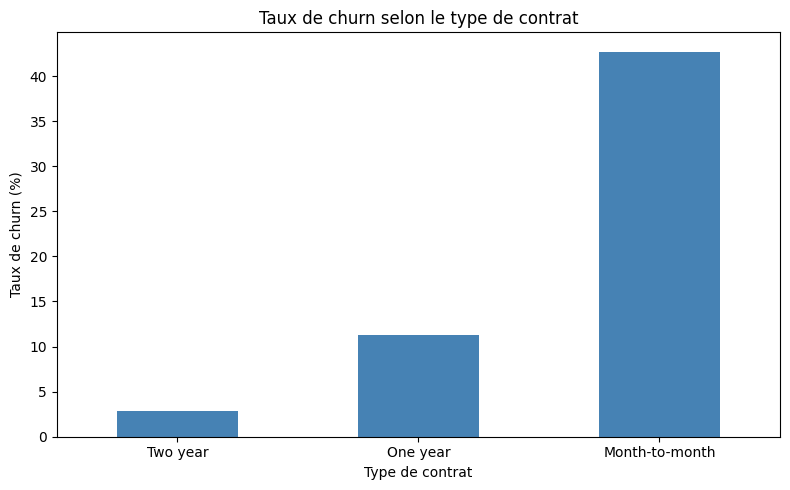
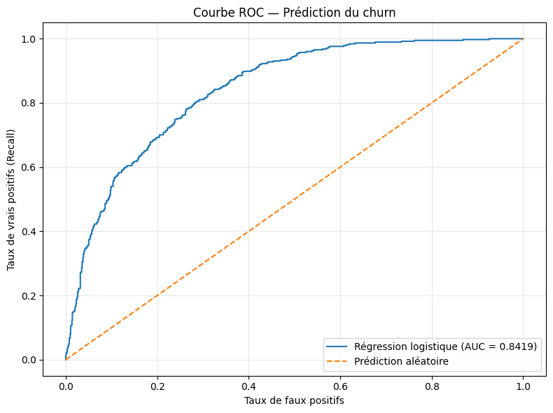
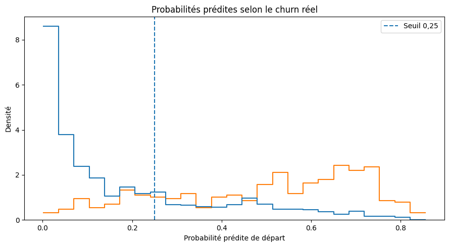

# Customer Churn Prediction — Visual Reports

Ce dossier contient les **8 graphiques originaux** fournis pour le projet Telco Customer Churn. Les images ont été conservées sans retouche ; seuls les noms de fichiers ont été normalisés pour GitHub.

## Graphiques

| Fichier | Description |
|---|---|
| `churn_distribution.png` | Répartition des clients selon le churn |
| `churn_by_contract.png` | Répartition du churn selon le type de contrat |
| `churn_rate_by_contract.png` | Taux de churn selon le type de contrat |
| `tenure_by_churn.png` | Durée d'abonnement selon le churn |
| `monthly_charges_by_churn.png` | Frais mensuels selon le churn |
| `churn_by_payment_method.png` | Répartition du churn selon le mode de paiement |
| `roc_curve.png` | Courbe ROC de la régression logistique (AUC = 0,8419 affichée) |
| `predicted_probabilities_by_churn.png` | Distribution des probabilités prédites avec seuil 0,25 |

## Aperçu

> Ces graphiques proviennent de l'analyse antérieure et ne constituent pas les résultats d'une nouvelle exécution du modèle.
